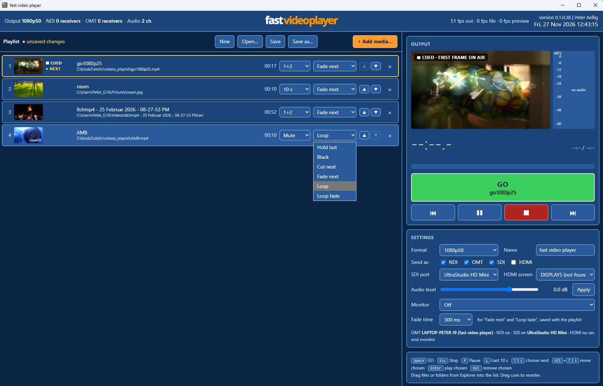

# fast video player 0.1.0.38

A Windows playout tool for single clips or a cue list. It sends video and audio over **NDI**, **OMT** and **SDI** (Blackmagic DeckLink / UltraStudio), with local audio monitoring.

**[Download the Windows x64 installer · version 0.1.0.38](https://github.com/peteraellig/fast-video-player/releases/download/v0.1.0.38/FastVideoPlayer-Setup-0.1.0.38.exe)**

## Features

- **Cue list.** Save playlists as `.cuelist` files. Reorder clips by dragging them, using the ▲ and ▼ buttons, or pressing Alt + arrow keys.
- **First frame ready.** When playback is stopped, the selected clip's first frame appears on all outputs.
- **End actions per clip.** Choose Hold last, Black, Cut next, Fade next, Loop or Loop fade. The playlist stores the fade time (100–1000 ms).
- **Seamless transitions.** Two playback decks let the next clip preroll while the current clip plays.
- **Countdown.** Use the **Last 10 s** button to jump to the final 10 seconds. An on-screen countdown shows the time remaining.
- **Audio choice per clip.** Select a stereo pair (1+2, 3+4, 5+6 or 7+8), play any single channel from 1–8 in mono on both output channels, or mute the clip. Single-channel selection is useful for files with one language per track.
- **Audio level meters.** See the level of every channel in the file.
- **Outputs.** The SDI card sets the pace for SDI playback. NDI and OMT show receiver counts. Choose any Windows audio device for local monitoring.

## Supported files

| Media | Formats |
| --- | --- |
| Video containers | `.mp4`, `.mov`, `.m4v`, `.mkv`, `.mxf`, `.avi`, `.wmv`, `.webm`, `.mpg`, `.mpeg`, `.ts`, `.m2ts`, `.mts`, `.flv` |
| Audio-only files | `.mp3`, `.wav`, `.aac`, `.m4a`, `.flac` |
| Video codecs via libVLC | H.264, H.265/HEVC, MPEG-2 (including XDCAM in MXF), ProRes, DNxHD/DNxHR, MJPEG, DV, VP8/VP9, AV1, WMV/VC-1 |
| vMix recordings | VMX1 video, decoded with libvmx |
| Audio codecs | PCM, AAC, MP3, AC-3, FLAC, Opus |
| Still Images | JPG, JPEG, PNG, BMP, GIF (only first image), TIFF / TIF

For files with several audio tracks or more than two channels, FFmpeg reads the channels in the file's own order. This requires 48 kHz audio.

The codec list includes formats libVLC normally handles. The combinations below have been tested with real files. When you add a file, the player checks it and shows “not supported” if it cannot decode the picture.

## Tested

| Container | Tested configuration |
| --- | --- |
| MP4 | H.264 video with stereo audio |
| MOV | ProRes video with one 8-channel audio track |
| MXF | Eight mono audio tracks |
| MXF | 16-channel test file |
| AVI | VMX1 video with one 8-channel audio track |
|     | all image formats

**Output tests** covered 1080p50 and 1080i50 over NDI, OMT and SDI. The SDI test used an Blackmagic SDI card.

**Not yet supported or tested** 59.94 output, 2160p over SDI, and files with more than two audio channels at sample rates other than 48 kHz. In those files, channel order may be incorrect.

## Requirements and installation

Run the installer on 64-bit Windows 10 or 11. It includes the .NET runtime. The interface requires the Microsoft Edge WebView2 Runtime.
For NDI output, install the NDI runtime separately. For SDI output, install Blackmagic Desktop Video separately.

## Build from source

Install the .NET 10 SDK on Windows. The project expects the OMT SDK files `libomt.dll` and `libvmx.dll` in `../sdi_converter/third_party/omt/Libraries/Winx64/`, relative to the project directory.

Run `dotnet build CuePlayer.csproj -c Release` to build the player. To create a self-contained installer, install Inno Setup and run `setup\build.cmd`. The installer is written to `publish/`.

## License

CuePlayer is released under the [BSD Zero Clause License (0BSD)](LICENSE). Bundled third-party components retain their respective licenses, listed in the [third-party notices](licence/THIRD-PARTY-NOTICES.txt).

by Peter Aellig and Claude Opus 5.5
